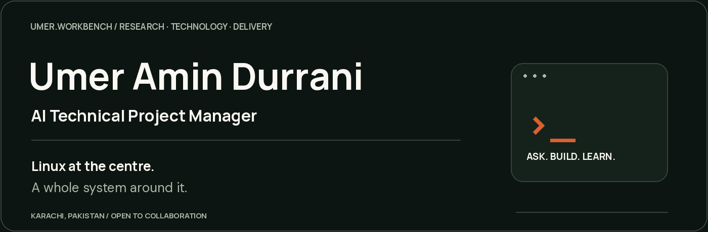
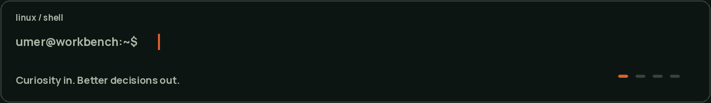

  

  <a href="https://umer-amin.vercel.app/">Portfolio</a> &nbsp; / &nbsp;
  <a href="https://www.linkedin.com/in/umer-amin-durrani/">LinkedIn</a> &nbsp; / &nbsp;
  <a href="https://www.credly.com/users/umer-amin.durrani">Credentials</a> &nbsp; / &nbsp;
  <a href="mailto:umeramindurrani@gmail.com">Contact</a>

# Umer Amin Durrani

**AI Technical Project Manager · Linux & DevOps · Research & AI automation**

I connect technical delivery, deep research and business thinking. Linux is the foundation of my workbench; engineering, AI, security, product and brand strategy are the disciplines around it.

Based in **Karachi, Pakistan**. Open to collaborators, teams and company contracts, with a particular interest in European collaboration.

  

## The workbench

### Linux, delivery & infrastructure

Linux and shell workflows · server environments · CI/CD · containers · Kubernetes · DevOps and security-conscious delivery.

### Software engineering

Django and MERN development · application architecture · APIs · data and workflow design.

### AI, data & investigation

AI prompting and automation · agent workflows · MLOps · data science · research design and algorithm investigations.

| Beyond the stack | What I focus on |
| --- | --- |
| Technical PM & product | Requirements, priorities, roadmaps, risks and delivery coordination |
| SecOps | Access boundaries, secrets, deployment safety and recovery planning |
| Deep research | Questions, source evaluation, methods, limitations and evidence |
| Market & brand | Market analysis, personal branding and brand organisation |

My implementation work is kept in private repositories. This profile brings together my capabilities, research interests and professional contact links.

## Explore the work

| Start here | What you’ll find |
| --- | --- |
| [Case studies](https://umer-amin.vercel.app/case-studies) | Technical decisions, architecture questions and delivery thinking |
| [Secret Research](https://umer-amin.vercel.app/research) | Research questions, methods and clearly labelled research designs |
| [Capabilities](https://umer-amin.vercel.app/capabilities) | The Linux-centred map connecting my disciplines |

## Work with me

Interested in an AI workflow, a Linux/DevOps problem, technical project delivery, research or brand strategy? Tell me what you are trying to achieve.

**[Explore my services](https://umer-amin.vercel.app/services)** · **[Connect on LinkedIn](https://www.linkedin.com/in/umer-amin-durrani/)** · **[Email me](mailto:umeramindurrani@gmail.com)**

---

*Curiosity in. Better decisions out.*
